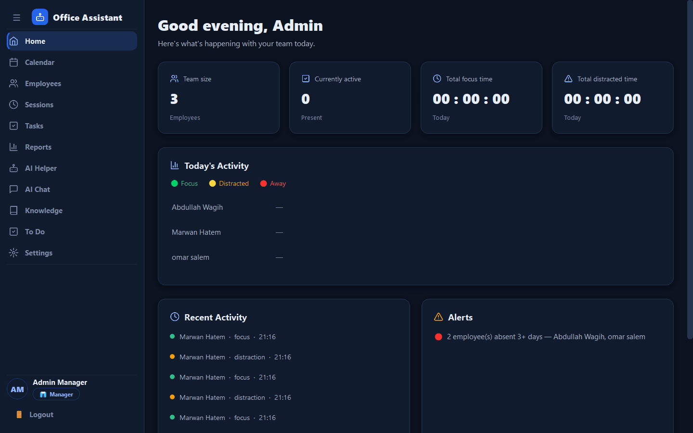
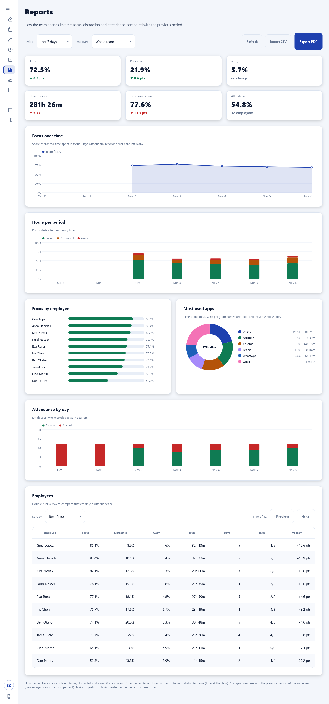
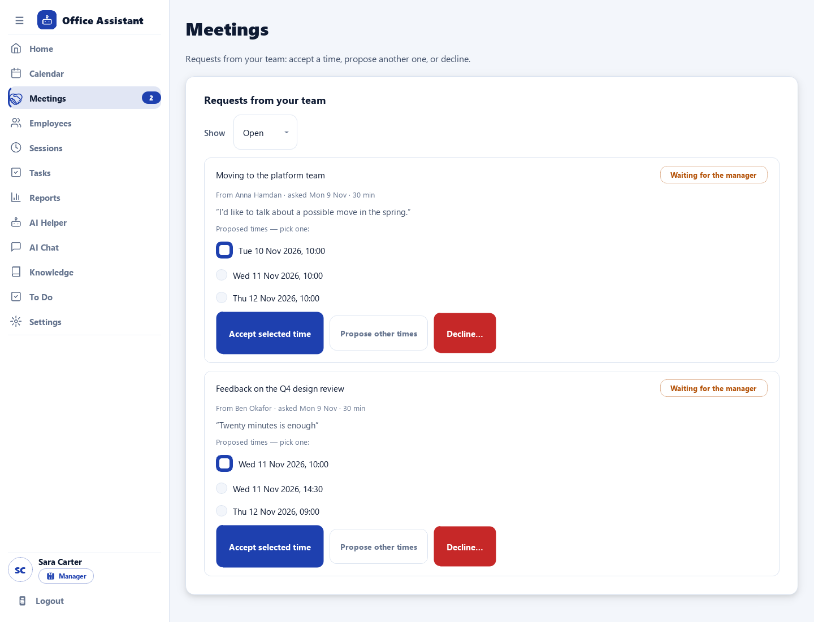
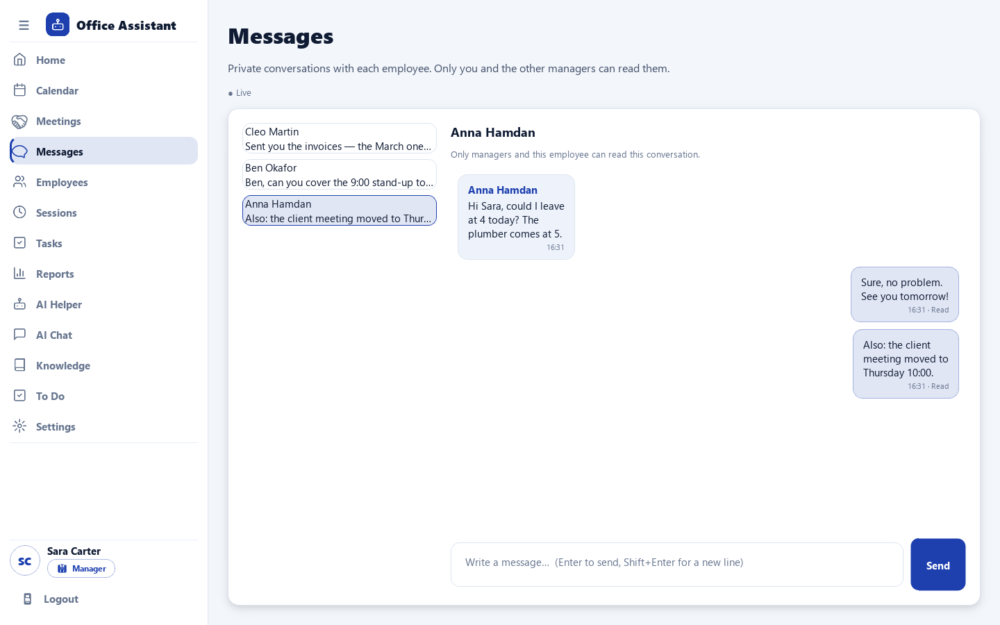
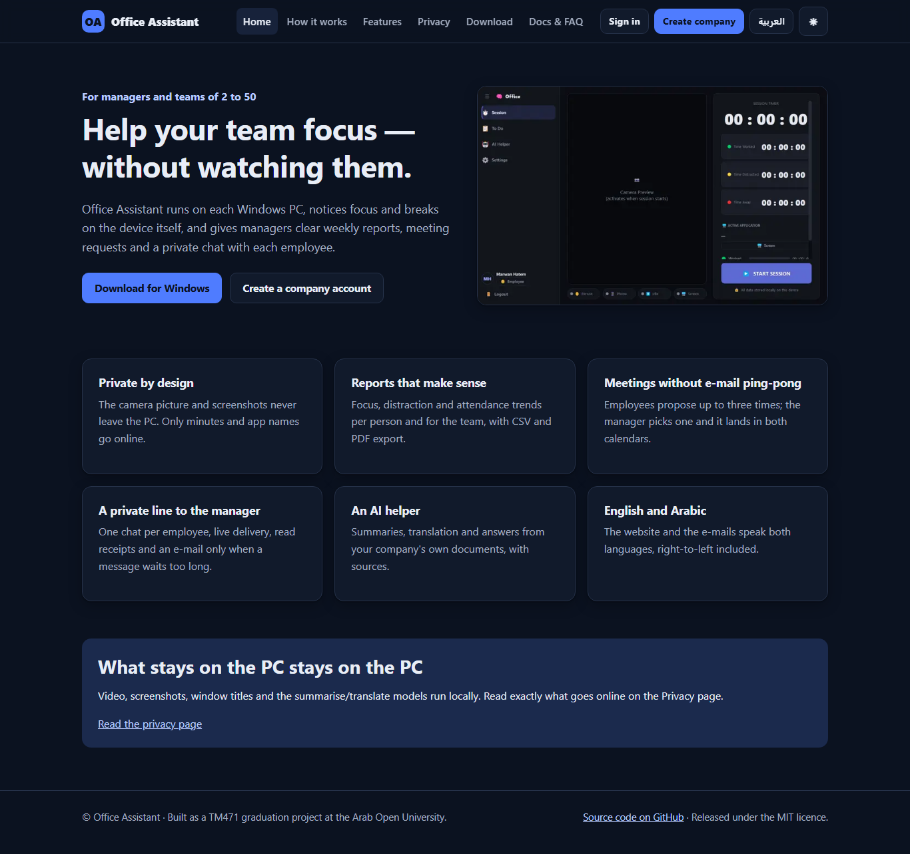

# Desktop AI Office Assistant (المساعد المكتبي الذكي)

A Windows desktop assistant for small companies, with an online service and a website:
employees track their work sessions with AI that runs **on their own PC** (camera, active window and
idle time), and managers get reports, tasks, meeting requests and a private chat with each employee —
in the app or on the website, from any device.

**Private by design**: the camera picture, screenshots and window titles never leave the PC. Only
session minutes, program names, tasks, meetings and messages go to the company's own account, and each
company's data is kept apart from every other company's (twice: in the code and by the database itself).

> University capstone project — TM471B, Arab Open University. Version 2.0 (online, multi-company).



| Reports | Meetings | Messages | Website |
|---|---|---|---|
|  |  |  |  |

---

## What it does

**Employees (desktop app)**
- **Work session** with three timers — *focus*, *distraction*, *away* — fed by YOLO12n person/phone
  detection on the webcam, the active window (productive / neutral / distracting) and keyboard/mouse idle
  time. Sessions keep running offline and are sent when the connection is back.
- **To-do** with the tasks your manager gave you, deadlines and reminders; **calendar** with invitations.
- **Meeting requests** to the manager (1–3 proposed times) and a **private chat** with the manager.
- **AI Helper**: summarise text or PDFs (BART) and translate between English, Arabic, French and German
  (MarianMT) — on the PC.
- **AI Chat**: questions about your tasks and calendar are answered from your data by the app's own intent
  classifier; general and document questions by an online model (Groq) through the company's server.

**Managers (app and website)**
- **Reports**: focus / distraction / away, hours, attendance, trends, ranking, most-used apps, per person
  and for the team, with week-over-week change; CSV and PDF export.
- **Employees**: approve people who join with the company code or an invite link, disable accounts.
- **Tasks** (urgent ones are e-mailed), **calendar**, **meeting requests** (accept, decline, propose other
  times), **messages** with live delivery and read receipts, **knowledge** documents for the AI Chat.

**Website** ([`website/`](website)): public pages in English and Arabic (right-to-left), dark and light;
company sign-up, sign-in, password reset; the portal with reports, employees, meetings and messages.

## Architecture

```
 Desktop app (Windows, PyQt5)        Website (Next.js)            Online service (FastAPI)
 ─ camera / window / idle → timers   ─ public pages, en/ar         ─ accounts, companies, invites
 ─ YOLO12n, BART, MarianMT,           ─ portal (reports, people,    ─ sessions, tasks, calendar, reports
   intent classifier: on the PC         meetings, chat)             ─ meeting requests, chat (WebSocket)
 ─ offline queue for sessions        ─ tokens in httpOnly cookies  ─ e-mail queue (Resend / SMTP / SendGrid)
            │  HTTPS + WebSocket                 │ HTTPS                ─ AI Chat prompt → Groq
            └──────────────────────────────┬─────┘                     PostgreSQL, Row-Level Security
                                           ▼
```

Details: [docs/ARCHITECTURE.md](docs/ARCHITECTURE.md) · deployment: [docs/PRODUCTION.md](docs/PRODUCTION.md).

## AI stack

| Model | Where | Purpose |
|---|---|---|
| YOLO12n (ultralytics) | PC | person and phone detection |
| BART-large-CNN | PC | summaries |
| MarianMT (Helsinki-NLP opus-mt, 12 pairs) | PC | translation |
| Own intent classifier (~1 MB, PyTorch) | PC | understands questions about tasks / calendar / team |
| `openai/gpt-oss-120b` at Groq | online, via the company's server | general and document questions in AI Chat |
| BM25 (own implementation) | server | finds passages in the company's documents (RAG) |

The local Qwen model of version 1 was removed: the installer is about 3 GB smaller. Details:
[docs/AI_STACK.md](docs/AI_STACK.md).

## Install (users) — no Python needed

1. Open the **[latest release](https://github.com/marwan55hatem/AI-Office-Assistant-App/releases/latest)**
   (or the website's *Download* page) and download **all files** into one folder:
   `OfficeAssistant-Setup.exe` and its `OfficeAssistant-Setup-*.bin` parts.
2. Double-click `OfficeAssistant-Setup.exe`. If Windows SmartScreen warns (the installer is not
   code-signed), click *More info → Run anyway*.
3. Start **Office Assistant**. A manager creates the company on the website or in the app; employees join
   with the company code or an invite link and sign in once the manager has approved them.

Requirements: Windows 10/11 64-bit, 8 GB RAM (16 GB recommended), a webcam, an internet connection for
reports, meetings, chat and the online model. An NVIDIA GPU makes summarising and translating faster
(it also works on the CPU). Full guide: [docs/INSTALL.md](docs/INSTALL.md).

## Run from source (developers)

```bash
git clone https://github.com/marwan55hatem/AI-Office-Assistant-App.git
cd AI-Office-Assistant-App
python -m venv .venv && .venv\Scripts\activate
pip install -r requirements.txt --extra-index-url https://download.pytorch.org/whl/cu130
python tools/fetch_models.py               # the local models, once
# the online service (needs Docker for PostgreSQL): see backend/README.md
set OFFICE_API_URL=http://localhost:8000
python main.py
```

The website: [website/README.md](website/README.md). More: [docs/DEVELOPMENT.md](docs/DEVELOPMENT.md).

## Tests

| Part | Command | Tests |
|---|---|---|
| Desktop app | `python -m pytest tests/` | 241 |
| Online service | `cd backend && python -m pytest` (PostgreSQL in Docker) | 223 |
| Website, unit | `cd website && npm test` | 28 |
| Website, end-to-end + accessibility | `cd website && npx playwright test` (API and site running) | 36 |
| Bundled models | `OfficeAssistant.exe --self-check` | 5 checks |

See [docs/TESTING.md](docs/TESTING.md). CI runs the website and the online service on every push.

## Project layout

```
main.py                   desktop app entry point (--self-check: the local models, for builds)
ui/  detection/  assistant/  chat/  knowledge/   desktop screens, session timers, local AI, chat routing
cloud/                    the desktop app's client for the online service (offline queue, live chat)
database/                 the local SQLite database (offline/development mode)
backend/                  the online service: FastAPI, PostgreSQL + Alembic, e-mail, AI Chat, chat
website/                  the website: Next.js, en/ar, portal
packaging/                PyInstaller spec, Inno Setup script, build script
docs/                     documentation
```

## Documentation

| Document | Content |
|---|---|
| [docs/INSTALL.md](docs/INSTALL.md) | installing, first start, uninstalling |
| [docs/USER_GUIDE.md](docs/USER_GUIDE.md) | every screen for employees and managers, app and website |
| [docs/PRIVACY.md](docs/PRIVACY.md) | what stays on the PC, what goes online, who sees what |
| [docs/PRODUCTION.md](docs/PRODUCTION.md) | deploying the service and the website, settings, backups, security checklist |
| [docs/DEPLOYMENT.md](docs/DEPLOYMENT.md) | building the Windows installer |
| [docs/DEVELOPMENT.md](docs/DEVELOPMENT.md) · [docs/TESTING.md](docs/TESTING.md) | developer setup, tests |
| [docs/ARCHITECTURE.md](docs/ARCHITECTURE.md) · [docs/AI_STACK.md](docs/AI_STACK.md) | modules and data flow, the models |
| [docs/TROUBLESHOOTING.md](docs/TROUBLESHOOTING.md) | common problems |
| [docs/CHANGELOG-cloud.md](docs/CHANGELOG-cloud.md) · [CHANGELOG.md](CHANGELOG.md) | how version 2 was built, versions |

## Privacy in one paragraph

Webcam frames are analysed in memory and never saved or sent; only "person present / phone visible"
reach the timers. Window titles stay on the PC; the server receives program names only (for example
"Word") and the session minutes. Passwords are hashed with Argon2id; sessions use short-lived tokens.
Employees cannot see other people's data or chats; the online model never receives tasks, calendars or
team numbers. Full details: [docs/PRIVACY.md](docs/PRIVACY.md).

## Licence

Own code: MIT — see [LICENSE](LICENSE). Models, libraries and online services keep their own licences
and terms — see [THIRD_PARTY_NOTICES.md](THIRD_PARTY_NOTICES.md) (note: ultralytics/YOLO is AGPL-3.0).
