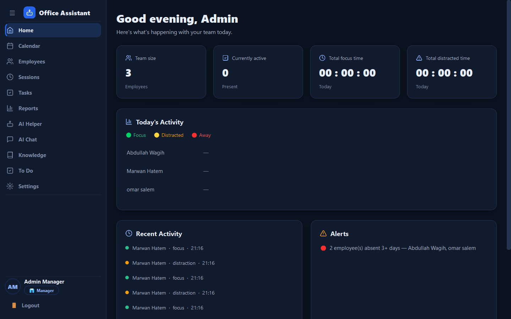
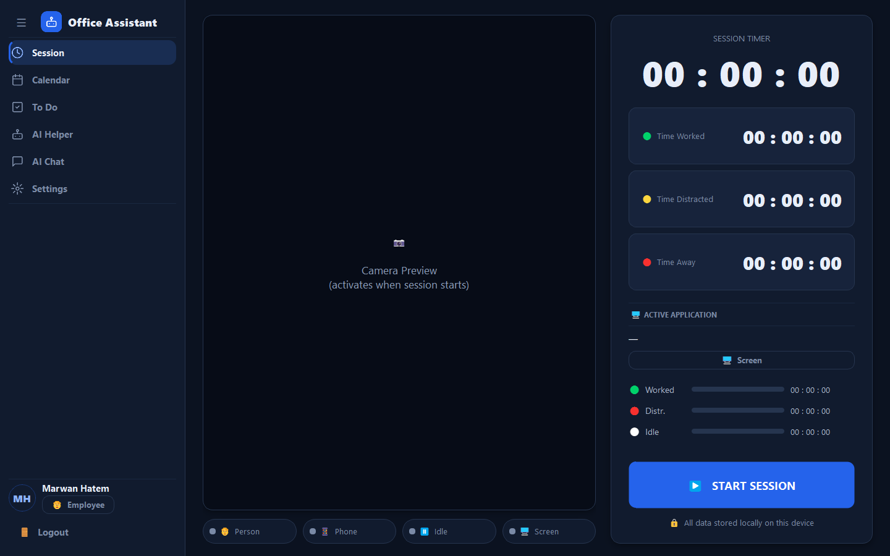
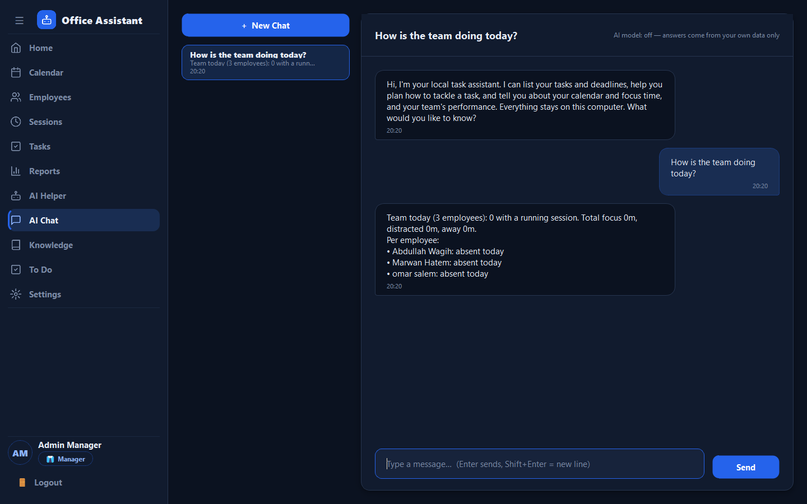
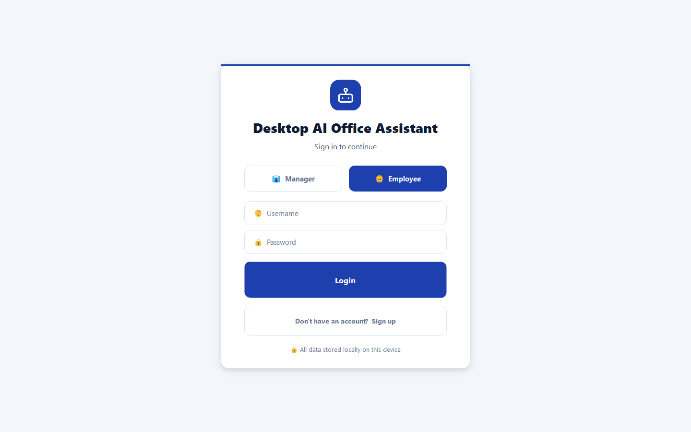

# Desktop AI Office Assistant

A **fully local** Windows desktop application that helps a small team work with focus:
employees track their work sessions (camera + active-window + keyboard idle detection),
managers see the team's day at a glance, and everyone gets on-device AI helpers —
summarising, translating and a chat assistant that answers from the team's own data and documents.

**Nothing leaves the computer**: no cloud API, no telemetry; every model runs locally.

> University capstone project — TM471B, Arab Open University.



| Employee session | AI Chat | Login |
|---|---|---|
|  |  |  |

---

## Features

**Employees**
- **Work session** with three timers — *focus*, *distraction*, *away* — fed by:
  YOLO12n person/phone detection on the webcam, the active-window title (productive / neutral /
  distracting; WhatsApp becomes a distraction after 90 s) and keyboard/mouse idle time.
- **To-do** list with manager-assigned tasks, descriptions and deadlines (badges, overdue alerts).
- **Calendar** with events and invitations; **tray notifications** for deadlines and events.
- **AI Helper**: summarise text or PDFs (BART) and translate between English, Arabic, French and German (MarianMT).
- **AI Chat**: ask about your tasks, deadlines, calendar and focus time; ask general questions
  ("how do I build a CNN?") answered by a local language model; answers cite the manager's documents.

**Managers**
- **Home dashboard**: who is working, team focus/distraction totals, activity feed, alerts.
- **Employees, Sessions, Tasks, Reports**: approve sign-ups, inspect sessions and their event log,
  assign tasks with deadlines, weekly reports.
- **AI Chat about the team** ("who should I check in on?", "weekly summary") — exact numbers from the database.
- **Knowledge**: upload `.txt` / `.md` notes and policies; mark each *Everyone* or *Managers only*.
- **Admin panel** (`OfficeAssistant-Admin.exe` / `python admin.py`): users, sessions, tasks, events, backups, factory reset.

**Everywhere**: dark and light themes (designed in Figma), automatic UI scaling for large screens.

## AI stack (all on-device)

| Model | Purpose |
|---|---|
| YOLO12n (ultralytics) | person and phone detection |
| BART-large-CNN | summaries |
| MarianMT (Helsinki-NLP opus-mt, 12 pairs) | translation |
| Own intent classifier (~1 MB, PyTorch) | understands questions about tasks / calendar / team |
| Qwen2.5-1.5B-Instruct | general questions in the chat (GPU, or CPU fallback) |
| BM25 (own implementation) | finds passages in the manager's documents (RAG) |

Details and measured performance: [docs/AI_STACK.md](docs/AI_STACK.md).

## Install (users) — no Python needed

1. Open the **[latest release](https://github.com/marwan55hatem/AI-Office-Assistant-App/releases/latest)**
   and download **all five files** into one folder:
   `OfficeAssistant-Setup.exe` and `OfficeAssistant-Setup-1.bin` … `-4.bin` (7.4 GB in total —
   the AI models are inside, so the app later works without internet).
2. Double-click `OfficeAssistant-Setup.exe`. If Windows SmartScreen warns (the installer is not
   code-signed), click *More info → Run anyway*.
3. Start **Office Assistant** from the Start menu or the desktop and log in with a demo account (below).

Requirements: Windows 10/11 64-bit, ~20 GB free disk while installing (12.2 GB after), 8 GB RAM (16 GB recommended), a webcam.
An NVIDIA GPU (driver 525+) makes the chat model fast; without one it runs on the CPU (slower).
Full guide: [docs/INSTALL.md](docs/INSTALL.md).

## Use in 5 minutes

1. **Log in** as `manager` / `1234`. Under **Tasks**, assign a task with a deadline to *marwan*;
   under **Calendar**, create an event and invite *marwan*.
2. Click **Logout** at the bottom of the sidebar and log in as `marwan` / `1234`. On **Session**, press **START SESSION** —
   the camera preview appears and the *worked / distracted / away* timers start. Press **STOP SESSION** when done.
3. Open **AI Chat** and ask *"What tasks do I have?"* or *"How do I write a good report?"*.
4. Open **AI Helper** to summarise a PDF or translate between English, Arabic, French and German.
5. Back as the manager, see the session under **Sessions**, the team on **Home**, and weekly **Reports**.
   Add a policy `.md` file under **Knowledge** — the chat then answers from it and cites it.

Every screen is explained in the [user guide](docs/USER_GUIDE.md).

**First login** — demo accounts (change the passwords in *Settings* right away):

| Role | Username | Password |
|---|---|---|
| Manager | `manager` | `1234` |
| Employee | `marwan` | `1234` |

Your data is stored per Windows user in `%LOCALAPPDATA%\OfficeAssistant` (database and logs).

## Run from source (developers)

Windows 10/11, Python 3.12. The model weights are not in the repository (too large for git);
`fetch_models.py` downloads them once.

```bash
git clone https://github.com/marwan55hatem/AI-Office-Assistant-App.git
cd AI-Office-Assistant-App
python -m venv .venv
.venv\Scripts\activate
pip install -r requirements.txt --extra-index-url https://download.pytorch.org/whl/cu124
python tools/fetch_models.py        # ~8 GB of models, once
python main.py                      # the application
python admin.py                     # the admin panel
```

More: [docs/DEVELOPMENT.md](docs/DEVELOPMENT.md). Build the installer: [docs/DEPLOYMENT.md](docs/DEPLOYMENT.md).

## Tests

```bash
pip install -r requirements-dev.txt
python -m pytest tests/             # 167 tests, temporary databases, no camera or model needed
python database/db_manager.py       # database self-test
python -m llm.selftest              # loads the real chat model (GPU)
```

See [docs/TESTING.md](docs/TESTING.md).

## Project layout

```
main.py / admin.py        entry points (application / admin panel)
app_paths.py              where files live (development vs installed)
self_check.py             `--self-check`: runs every bundled model once (build verification)
ui/                       screens, theme (QSS design system), icons, widgets
admin_ui/                 admin panel tabs
detection/                camera + YOLO, active window, idle time, session timers
assistant/                chat engine (intent classifier), summariser, translator
chat/                     chat backend contract + local backend (routing engine / model / documents)
llm/                      local language model: loading, streaming, prompts
knowledge/                document store + BM25 search
database/                 SQLite schema, migrations, repositories
tests/                    pytest suite
tools/                    fetch models, make icon, code audit, generate DB docs
packaging/                PyInstaller spec, Inno Setup script, build script
docs/                     documentation
```

## Documentation

| Document | Content |
|---|---|
| [docs/INSTALL.md](docs/INSTALL.md) | installing, first start, uninstalling |
| [docs/USER_GUIDE.md](docs/USER_GUIDE.md) | every screen for employees and managers |
| [docs/DEVELOPMENT.md](docs/DEVELOPMENT.md) | developer setup and everyday commands |
| [docs/DEPLOYMENT.md](docs/DEPLOYMENT.md) | building the offline Windows installer |
| [docs/TESTING.md](docs/TESTING.md) | automated and manual tests |
| [docs/TROUBLESHOOTING.md](docs/TROUBLESHOOTING.md) | common problems and fixes |
| [docs/ARCHITECTURE.md](docs/ARCHITECTURE.md) | modules, layers, data flow |
| [docs/DATABASE.md](docs/DATABASE.md) | schema, migrations, every method (generated) |
| [docs/AI_STACK.md](docs/AI_STACK.md) | the models and why |
| [docs/THREADING.md](docs/THREADING.md) | threads and safety rules |
| [docs/PRIVACY.md](docs/PRIVACY.md) | what is collected and who sees what |
| [docs/DESIGN.md](docs/DESIGN.md) | visual design, colour tokens, Figma file |
| [CHANGELOG.md](CHANGELOG.md) | versions |

Code-quality reports: [quality_audit_before.md](quality_audit_before.md), [quality_audit_after.md](quality_audit_after.md),
[SOLID_NOTES.md](SOLID_NOTES.md), [CLEAN_CODE.md](CLEAN_CODE.md).

## Privacy in one paragraph

Webcam frames are analysed in memory and never saved; only "person present / phone visible"
reach the timers. Window titles are classified, shown to the employee, and not stored.
No keystrokes are recorded — only "seconds since last input". Employees cannot see other
people's data; the chat model never receives database contents. Known limitation: passwords are
stored as typed. Full details: [docs/PRIVACY.md](docs/PRIVACY.md).

## Licence

Own code: MIT — see [LICENSE](LICENSE). Bundled models and libraries keep their own licences —
see [THIRD_PARTY_NOTICES.md](THIRD_PARTY_NOTICES.md) (note: ultralytics/YOLO is AGPL-3.0).
